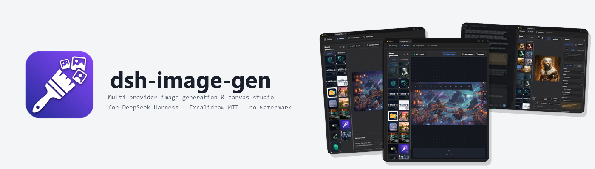
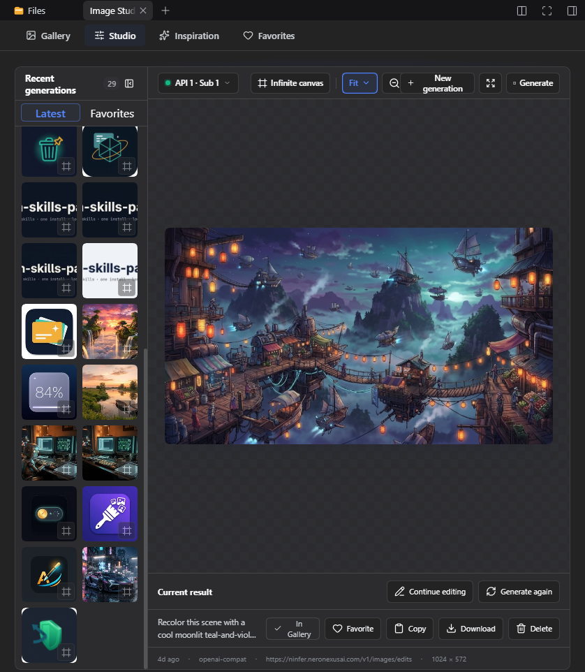
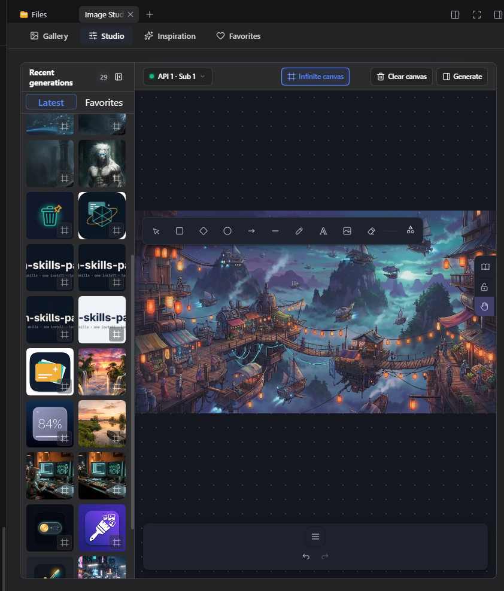
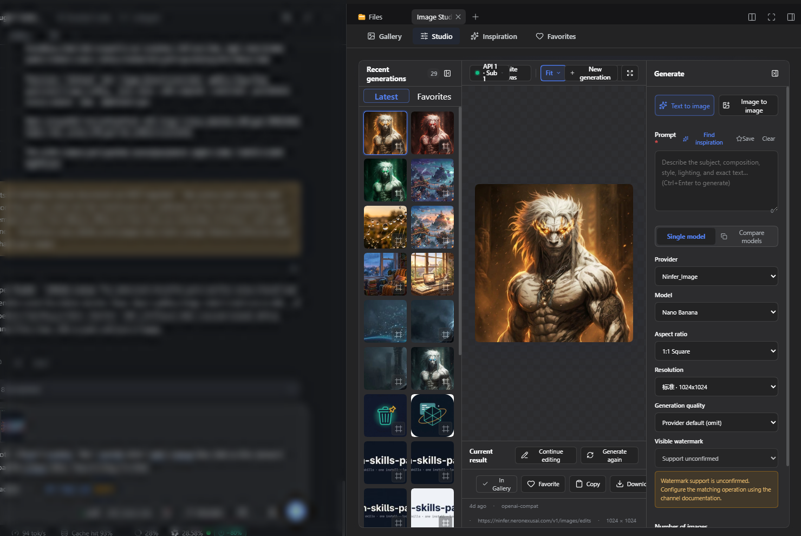
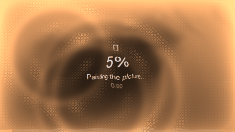
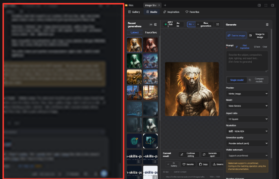

<picture>
  <source media="(prefers-color-scheme: dark)" srcset="assets/banner-dark.png">
  
</picture>

<br>

# dsh-image-gen

English | [中文](README.zh-CN.md)

    

Custom multi-provider image generation, editing, and interactive canvas studio plugin for **DeepSeek Harness (DSH)**, with native support for custom `/v1/images/generations` and `/v1/images/edits` endpoints.

---

## Features

- **Custom `/v1/images/generations` Endpoint Support**: Configure any OpenAI-compatible gateway, reverse proxy, or self-hosted server (vLLM, LiteLLM, OneAPI, NewAPI, LocalAI, SGLang) using either the `/v1` base URL or the full `/v1/images/generations` endpoint URL.
- **Multiple Named Relay Channels**: Add and switch between multiple independent OpenAI-compatible endpoints, each with its own API key, base URL, model catalog, quality tiers, and extra JSON payload fields.
- **Multi-Provider Support**:
  - OpenAI & OpenAI-Compatible Relays (`/v1/images/generations`, `/v1/images/edits`)
  - Google Gemini (`interactions` and native `generateContent`)
  - ByteDance Seedream (Volcengine Ark)
  - Aliyun DashScope (Qwen Image / Wanx)
  - xAI Grok Imagine
  - Zhipu GLM-Image
  - Local ComfyUI (custom API workflow JSONs)
  - Subscription Accounts (ChatGPT, Grok, Google Antigravity)
- **Agent Tools**:
  - `generate_image`: Single text-to-image generation.
  - `generate_images`: Sequential batch generation (up to 10 prompts per call).
  - `edit_image`: Image-to-image editing, restyling, and multi-reference composition.
  - `find_inspiration`: Prompt template search across bundled style and layout catalogs.
  - `canvas_state` & `view_canvas`: Live infinite canvas inspection and sketch-to-image workflows.
- **Interactive Workbench**: Gallery, Studio, Multi-Model Comparison, and an Excalidraw-based Infinite Canvas (MIT, no watermark) directly inside the DSH Web GUI.
- **Pro Image Viewer**: Fullscreen lightbox with pointer-anchored zoom, drag-pan, touch pinch, double-click 100%, keyboard navigation, and region annotations that bake numbered markers into a PNG and drop it (plus your notes) into the composer draft without sending.

---

## Screenshots

**Studio preview** — the recent-generations rail beside a fit-to-window preview of the current result.



**Infinite canvas (Excalidraw)** — the MIT-licensed sketch surface (dark skin, dot grid, tool strip). Select a rail image and click the canvas to place it, or drag thumbnails straight in; select shapes and feed them to `edit_image` as original-resolution references.



**Generate panel** — text-to-image / image-to-image controls with provider, model, ratio, resolution and quality, docked beside the canvas.



**Loading animation** — the amber "picture being made" water sheet with stage, elapsed time and a progress bar, then a radial ripple-reveal into the finished image.



**Markup** — draw rectangles, arrows, ellipses, numbered steps, redactions, freehand and text on any previewed image (including chat-bar attachments). Save bakes the marks into the original pixels, replaces the composer attachment in place, and appends normalized `(x%,y%)` coordinates so the model can ground each mark precisely.



---

## Custom `/v1/images/generations` Configuration

1. Open **Plugins → Installed → dsh-image-gen** in the DSH Web GUI.
2. Expand **OpenAI Compatible (relay)** (or click **+** to add a named channel).
3. Enter your **API Key** and **Endpoint / Base URL**:
   - Full endpoint URL: `https://your-host.example.com/v1/images/generations`
   - Or base URL: `https://your-host.example.com/v1`
4. Enter your model name (or click **Fetch models**), configure any custom resolution table or extra JSON body fields, and click **Save**.

---

## Development & Build

```bash
pnpm install
pnpm run typecheck
pnpm run build
pnpm test
```

### Local Profile Linking

```bash
dsh plugin --profile desktop add link:B:/Research/dsh-image-gen
dsh plugin --profile web add link:B:/Research/dsh-image-gen
```

---

## License

GPL-3.0-or-later — see [LICENSE](LICENSE).

The infinite canvas bundles [Excalidraw](https://github.com/excalidraw/excalidraw) (MIT, © 2020 Excalidraw). See [THIRD_PARTY_NOTICES.md](THIRD_PARTY_NOTICES.md).
