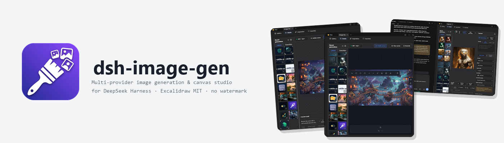
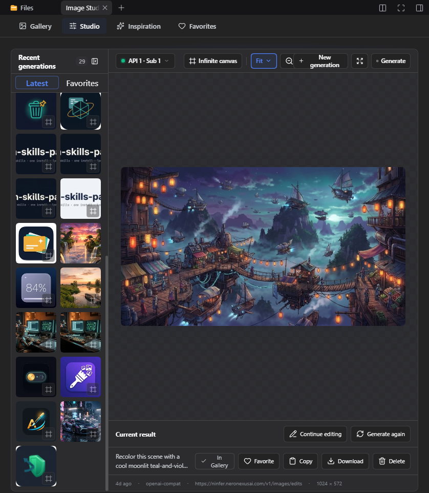
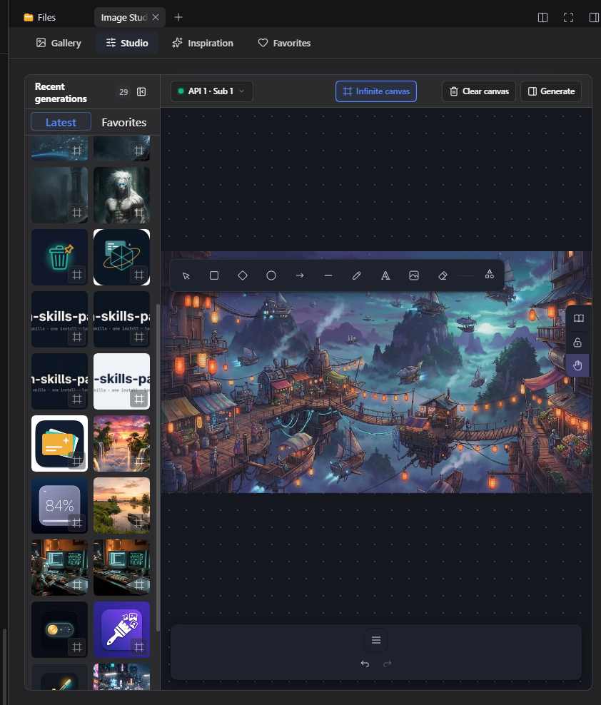
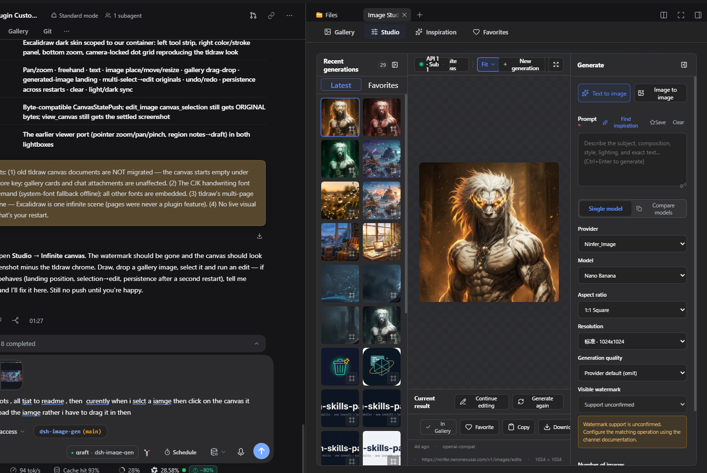

<picture>
  <source media="(prefers-color-scheme: dark)" srcset="assets/banner-dark.png">
  
</picture>

<br>

# dsh-image-gen

[English](README.md) | 中文

    

面向 **DeepSeek Harness (DSH)** 的多提供商图像生成、编辑与交互式画布工作台插件，原生支持自定义 `/v1/images/generations` 与 `/v1/images/edits` 端点。

---

## 功能

- **自定义 `/v1/images/generations` 端点**：可配置任意 OpenAI 兼容网关、反向代理或自建服务（vLLM、LiteLLM、OneAPI、NewAPI、LocalAI、SGLang），既接受 `/v1` 基础 URL，也接受完整的 `/v1/images/generations` 端点 URL。
- **多命名中转渠道**：添加并切换多个相互独立的 OpenAI 兼容端点，各自拥有 API Key、基础 URL、模型清单、清晰度档位与额外 JSON 请求体字段。
- **多提供商支持**：
  - OpenAI 与 OpenAI 兼容中转（`/v1/images/generations`、`/v1/images/edits`）
  - Google Gemini（`interactions` 与原生 `generateContent`）
  - 字节 Seedream（火山方舟）
  - 阿里 DashScope（通义万相 / Qwen Image）
  - xAI Grok Imagine
  - 智谱 GLM-Image
  - 本地 ComfyUI（自定义 API 工作流 JSON）
  - 订阅账号（ChatGPT、Grok、Google Antigravity）
- **Agent 工具**：
  - `generate_image`：单张文生图。
  - `generate_images`：顺序批量生成（每次调用最多 10 条提示词）。
  - `edit_image`：图生图编辑、重绘与多参考图合成。
  - `find_inspiration`：在内置风格与排版目录中检索提示词模板。
  - `canvas_state` 与 `view_canvas`：实时无限画布检视与草图生图工作流。
- **交互式工作台**：图库、工作台、多模型对比，以及基于 Excalidraw（MIT、无水印）的无限画布，直接内嵌于 DSH Web GUI。
- **专业图片查看器**：全屏灯箱，支持以指针为中心缩放、拖拽平移、双指捏合、双击 100%、键盘导航；区域标注会把编号标记烙进 PNG，并连同备注一起放入输入框草稿而不自动发送。

---

## 截图

**工作台预览** —— 最近生成栏与当前结果的适应窗口预览并排。



**无限画布（Excalidraw）** —— MIT 许可的草图画布（深色皮肤、点阵网格、工具条）。选中栏中图片后点击画布即可放置，或直接拖入缩略图；框选元素后可作为原始分辨率参考图交给 `edit_image`。



**生成面板** —— 文生图 / 图生图控制项（提供商、模型、比例、分辨率、清晰度），停靠在画布旁。



---

## 自定义 `/v1/images/generations` 配置

1. 在 DSH Web GUI 打开 **插件 → 已安装 → dsh-image-gen**。
2. 展开 **OpenAI Compatible (relay)**（或点 **+** 新增命名渠道）。
3. 填写 **API Key** 与 **端点 / 基础 URL**：
   - 完整端点 URL：`https://your-host.example.com/v1/images/generations`
   - 或基础 URL：`https://your-host.example.com/v1`
4. 填写模型名（或点 **Fetch models**），按需配置自定义分辨率表与额外 JSON 请求体字段，点 **保存**。

---

## 开发与构建

```bash
pnpm install
pnpm run typecheck
pnpm run build
pnpm test
```

### 本地 profile 链接

```bash
dsh plugin --profile desktop add link:B:/Research/dsh-image-gen
dsh plugin --profile web add link:B:/Research/dsh-image-gen
```

---

## 许可

GPL-3.0-or-later —— 见 [LICENSE](LICENSE)。

无限画布内置 [Excalidraw](https://github.com/excalidraw/excalidraw)（MIT，© 2020 Excalidraw）。见 [THIRD_PARTY_NOTICES.md](THIRD_PARTY_NOTICES.md)。
