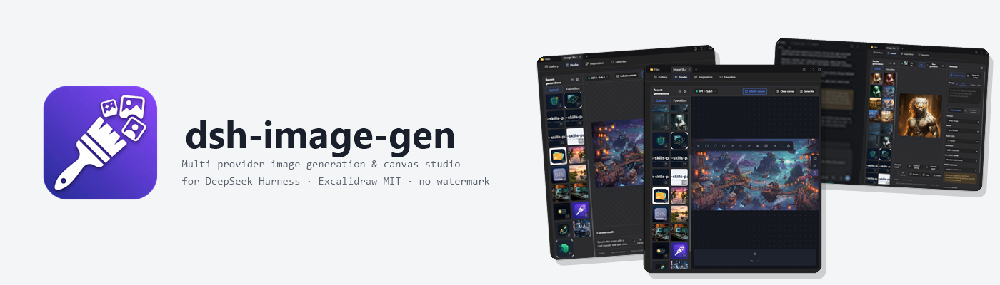
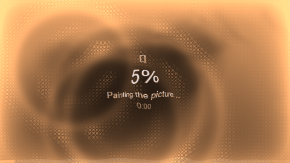
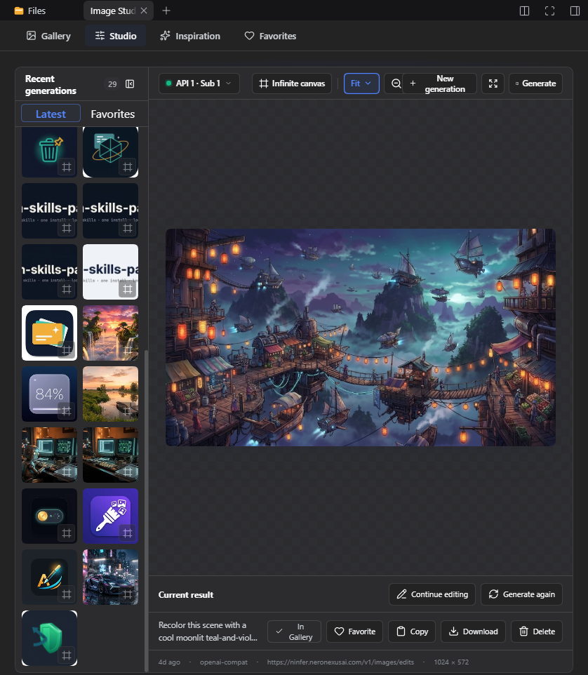
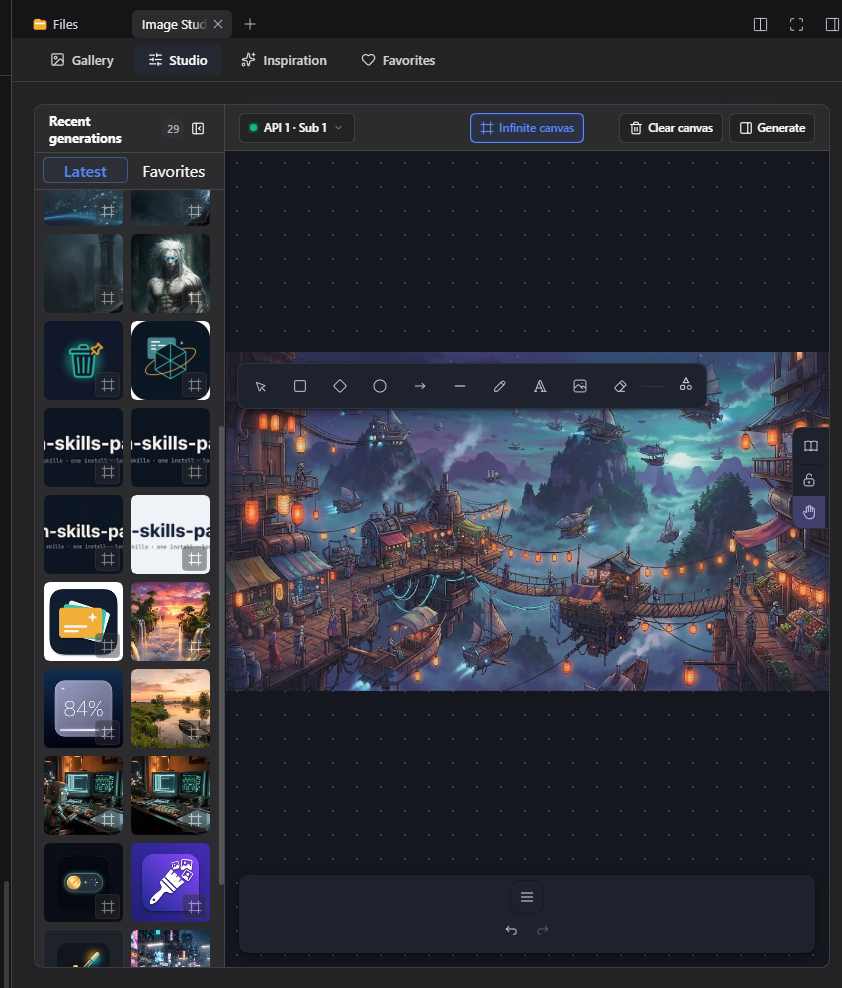
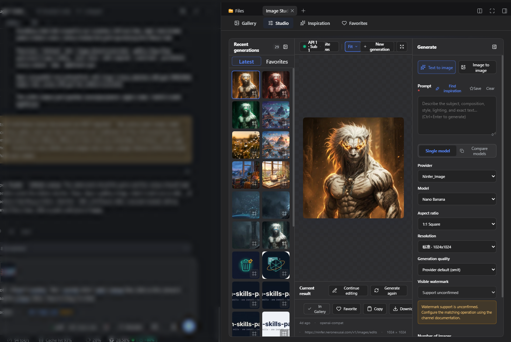
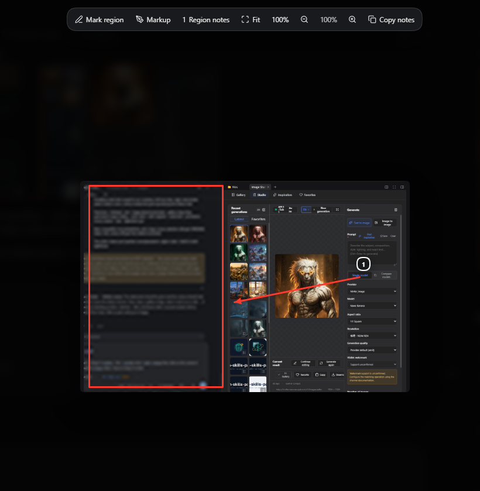
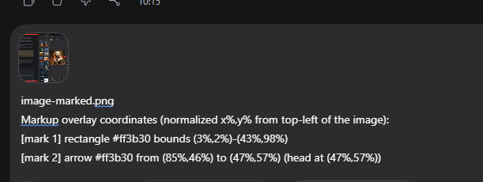

<picture>
  <source media="(prefers-color-scheme: dark)" srcset="assets/banner-dark.png">
  
</picture>

# dsh-image-gen

A [DeepSeek Harness](https://github.com/deepseek-ai/deepseek-harness) plugin for multi-provider image generation & editing, with an [Excalidraw](https://github.com/excalidraw/excalidraw) (MIT) infinite-canvas studio and a pro zoom / annotate / markup image viewer. Native support for custom `/v1/images/generations` and `/v1/images/edits` endpoints.

[View on GitHub](https://github.com/adithyanraj03/dsh-image-gen){: .btn }

   

---

## Install

From npm:

```sh
dsh plugin --profile web add @adithyanraj/dsh-image-gen
```

From the GitHub release (writes the dependency and mounts the row in one step):

```sh
dsh plugin --profile web add https://github.com/adithyanraj03/dsh-image-gen/releases/latest/download/plugin.tgz
```

Or from the repo tag:

```sh
dsh plugin --profile web add github:adithyanraj03/dsh-image-gen#v1.0.0
```

Restart dsh / the desktop app afterwards (the host half loads at startup). For the desktop profile use `--profile desktop`.



## What it does

- **Custom endpoints** — any OpenAI-compatible gateway / relay / self-hosted server via `/v1` base URL or the full `/v1/images/generations` URL; multiple named relay channels.
- **Multi-provider** — OpenAI & relays, Google Gemini, ByteDance Seedream, Aliyun DashScope, xAI Grok, Zhipu GLM, local ComfyUI, and subscription accounts (ChatGPT / Grok / Google).
- **Agent tools** — `generate_image`, `generate_images`, `edit_image`, `find_inspiration`, `canvas_state`, `view_canvas`.
- **Workbench** — Gallery, Studio, multi-model compare, and an Excalidraw infinite canvas (MIT, no watermark): click-to-place, drag-drop, selection → original-resolution edit references, persistence, undo/redo.
- **Pro viewer** — pointer-anchored zoom / pan / pinch, double-click 100%, keyboard nav; region notes and a full **Markup** mode (pen / line / arrow / rect / ellipse / step / redact / text) that bakes marks into the pixels, replaces the composer attachment in place, and sends normalized `(x%,y%)` coordinates so the model can ground each mark.

## Screenshots







## License

GPL-3.0-or-later. The infinite canvas bundles [Excalidraw](https://github.com/excalidraw/excalidraw) (MIT, © 2020 Excalidraw); see [THIRD_PARTY_NOTICES.md](https://github.com/adithyanraj03/dsh-image-gen/blob/main/THIRD_PARTY_NOTICES.md).
